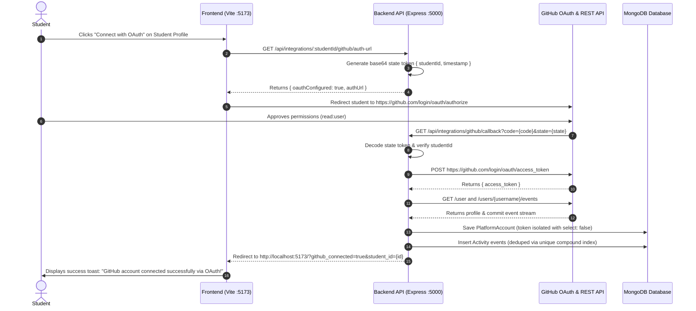

# Student360 — GitHub OAuth 2.0 Setup & Integration Guide

This guide documents how to configure and operate the **GitHub OAuth 2.0 Web Application Flow** in Student360 for seamless 1-click student account authorization.

---

## 1. Authentication Architecture

Student360 supports two authorized connection methods for GitHub:

| Authentication Method | Use Case | Setup Complexity | Student Experience |
| :--- | :--- | :--- | :--- |
| **Personal Access Token (PAT)** | Default / Zero-Config | None (built-in fallback) | Student generates `ghp_...` token with `read:user` scope |
| **OAuth 2.0 Web Flow** | Production / Institutional | Requires GitHub OAuth App registration | 1-Click "Authorize on GitHub" redirect with instant return |

Both flows enforce identical security policies:
- **Zero Token Leakage:** Tokens are stored in MongoDB with `{ select: false }` and stripped from all API outputs.
- **Least Privilege:** Only read access to public profile and events (`read:user`) is requested.
- **Deduplication:** MongoDB compound unique index `{ studentId: 1, externalId: 1 }` prevents duplicate records.

---

## 2. Step-by-Step GitHub OAuth App Setup

### Step 1: Register New OAuth Application
1. Sign in to [GitHub](https://github.com/).
2. Navigate to **Settings** > **Developer Settings** > **OAuth Apps** (or directly visit [https://github.com/settings/developers](https://github.com/settings/developers)).
3. Click the **"New OAuth App"** button (or **"Register a new application"**).

### Step 2: Fill in Application Details
Fill in the configuration fields with the following values:

| Field Name | Value for Development | Value for Production |
| :--- | :--- | :--- |
| **Application name** | `Student360 Analytics (Dev)` | `Student360 Platform` |
| **Homepage URL** | `http://localhost:5173` | `https://your-domain.edu` |
| **Application description** | Student learning activity and coding performance tracker | Institutional learning analytics portal |
| **Authorization callback URL** | `http://localhost:5000/api/integrations/github/callback` | `https://api.your-domain.edu/api/integrations/github/callback` |

> [!IMPORTANT]
> The **Authorization callback URL** must match the backend callback endpoint exactly: `http://localhost:5000/api/integrations/github/callback`. Any mismatch will cause GitHub to return an `invalid_request` redirect error.

4. Click **"Register application"**.

### Step 3: Generate Client Secret
1. On your newly created application page, copy the **Client ID** (e.g., `Iv1.xxxxxxxxxxxx`).
2. Click **"Generate a new client secret"**.
3. Confirm with your GitHub password or 2FA prompt.
4. Copy the generated **Client Secret** immediately (GitHub will not display it again).

---

## 3. Backend Environment Configuration

Open `c:\Student360\backend\.env` (or copy from `backend/.env.example`) and populate the OAuth environment keys:

```ini
PORT=5000
MONGO_URI=mongodb://127.0.0.1:27017/student360

# GitHub OAuth Web Flow Credentials
GITHUB_CLIENT_ID=your_github_client_id_here
GITHUB_CLIENT_SECRET=your_github_client_secret_here
GITHUB_CALLBACK_URL=http://localhost:5000/api/integrations/github/callback
FRONTEND_URL=http://localhost:5173
```

Restart the backend server for changes to take effect:
```bash
cd backend
npm start
```

---

## 4. End-to-End OAuth Sequence



---

## 5. Security & Isolation Guarantees

1. **State Token Tamper Prevention:**
   The `state` parameter carries a base64-encoded payload containing the target `studentId` and an epoch timestamp. The callback endpoint verifies the state parameter before attempting token exchange, preventing cross-student session hijacking.

2. **Schema-Level Token Exclusion:**
   In `backend/models/PlatformAccount.js`:
   ```javascript
   accessToken: {
     type: String,
     select: false // Automatically excluded from find, findOne, aggregate, and populate queries
   }
   ```
   Even if a developer executes `await PlatformAccount.find()`, Mongoose strips the token from memory.

3. **Least-Privilege Authorization:**
   Student360 requests exclusively `scope=read:user`. It cannot modify code, access private repositories, delete branches, or write issues.

4. **Zero-Configuration Fallback:**
   If `GITHUB_CLIENT_ID` or `GITHUB_CLIENT_SECRET` are omitted, the system continues functioning smoothly. The frontend gracefully shows the Personal Access Token entry field with detailed instructions.

---

## 6. Automated Verification

Run the dedicated OAuth automated test suite to verify routing, state parameter handling, and error redirects:

```bash
node backend/tests/oauthFlowTest.js
```

Expected output:
```text
======================================================
Student360 — GitHub OAuth Web Flow Automated Tests
======================================================

--- Step 1: Discover Active Test Student ---
  [PASS] Students API responds with HTTP 200
  [PASS] Found enrolled students in MongoDB

--- Step 2: Test OAuth Auth-URL Generation Endpoint ---
  [PASS] Auth-URL endpoint responds with HTTP 200
  [PASS] Properly flags oauthConfigured: false when GITHUB_CLIENT_ID is absent
  [PASS] Provides helpful message pointing to Personal Access Token fallback

--- Step 3: Test OAuth Callback Error Handling ---
  [PASS] Callback responds with HTTP 302 redirect on GitHub error
  [PASS] Redirects back to frontend with ?oauth_error parameter
  [PASS] Callback returns HTTP 400 when code/state are missing
  [PASS] Returns clear validation message for missing parameters
  [PASS] Callback returns HTTP 400 on malformed state token
  [PASS] Callback handles code exchange gracefully without crashing server

======================================================
Results: 11 PASSED, 0 FAILED
======================================================
```
