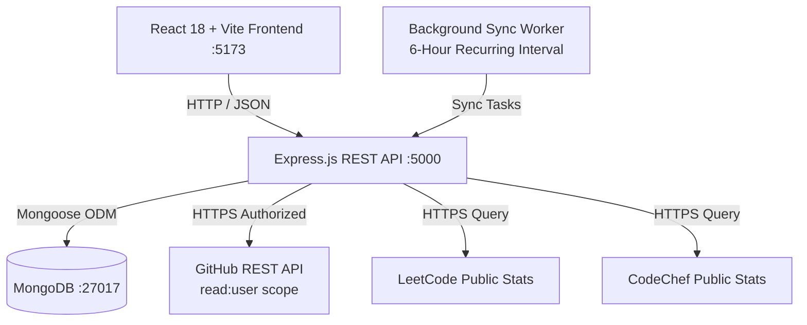

# Student360 — College Project Demonstration & Viva Guide

A comprehensive technical reference and oral examination guide for **Student360 – Learning Activity & Performance Analytics**.

---

## 1. Project Elevator Pitch (For Evaluators & Recruiters)

> **"Student360 is an institutional learning activity and coding performance analytics platform built using the MERN stack (MongoDB, Express, React, Node.js). It aggregates verified programming milestones across GitHub, LeetCode, and CodeChef alongside internal classroom survey feedback. By providing real-time active vs. inactive learner rosters, automated background synchronization, faculty inactivity alerts with a persistent audit trail, and multi-format accreditation reports (CSV and PDF), Student360 empowers educational institutions to identify disengaged students early and maintain comprehensive compliance documentation."**

---

## 2. System Architecture & High-Level Design

### Key Engineering Principles
1. **Separation of Concerns:** Strict MVC structure on the backend (`models/`, `controllers/`, `routes/`, `services/`).
2. **Zero-Token Exposure:** External tokens stored with `{ select: false }` in Mongoose and never passed into browser payloads.
3. **Idempotent Synchronization:** Compound unique indexes (`{ studentId: 1, externalId: 1 }`) prevent duplicate activity insertion even during server restarts or repetitive syncs.
4. **Lightweight Modern UI:** Vanilla CSS design tokens with pure CSS conic-gradient charts, eliminating bloated heavy chart libraries while maintaining high performance.

---

## 3. Database Schema Overview

| Collection / Model | Primary Purpose | Key Fields & Indexes |
| :--- | :--- | :--- |
| **`Student`** | Core student profile & cohort grouping | `name`, `email`, `department`, `year`, `rollNo`, `activeToday`, `streak` |
| **`Activity`** | Individual coding events, commits & tasks | `studentId`, `platform`, `activityType`, `activityDate`, `externalId`. **Unique Compound Index:** `{ studentId: 1, externalId: 1 }` |
| **`PlatformAccount`** | Multi-platform handles & credential store | `studentId`, `platform`, `username`, `accessToken` (`select: false`), `syncStatus`, `metrics`. **Unique Compound Index:** `{ studentId: 1, platform: 1 }` |
| **`Poll`** | Classroom surveys & engagement tracking | `title`, `description`, `options`, `responses` (`studentId`, `optionIndex`, `timestamp`) |
| **`NotificationLog`** | Inactivity alert dispatch audit trail | `studentId`, `alertType`, `targetDate`, `channel`, `status`, `message`, `sentAt` |

---

## 4. Live Project Demonstration Script (5-Minute Walkthrough)

### Step 1: Analytics Dashboard (`/`)
- Point out the top **KPI Metric Cards**: Total Students (21), Active Today, Inactive Today, and Survey Responses.
- Highlight the **Today's Platform Activity** card showcasing the counter of verified GitHub accounts.
- Showcase the **Donut Chart** representing survey turnout rendered with pure CSS conic gradients.
- Point out the **Recent Activity Feed** highlighting the **Real** vs. **Sample** badge system, demonstrating transparent data provenance.
- Click the **"Sync Platforms"** header button to trigger immediate background synchronization across all connected student accounts with spinning feedback and toast notification.

### Step 2: Global Header Search Navigation
- Type a student name (e.g. `Anu` or `Praveen`) in the global search bar in the header.
- Press **Enter**: Notice the automatic, seamless navigation to the `/students` page with the filter instantly applied.

### Step 3: Student Directory & Authorized Platform Linking (`/students`)
- Filter students by Department (e.g., `CSE`, `AI&DS`).
- Click on any student (e.g. *Praveen*) to open their detailed **Student Profile Modal**.
- Scroll to the **Platform Accounts** section:
  - Demonstrate GitHub connection: show both **Personal Access Token** entry and **OAuth 2.0 Web Flow** option.
  - Explain that tokens use `read:user` least-privilege scope and are stored with Mongoose `{ select: false }`.
  - Connect LeetCode / CodeChef handles and click **"Sync Now"**.

### Step 4: Daily Activity Roster & Alert Dispatch (`/activity`)
- Click **"Activity"** on the sidebar.
- Walk through the interactive **Daily Attendance & Activity Roster**:
  - Use the calendar date picker and shortcut buttons (*Today*, *Oct 9 Benchmark*, *Oct 8*).
  - Review the summary chips: Total, Active Learners (with platform solve breakdown), and Inactive Learners.
  - Switch to the **Inactive Learners** tab showing disengaged students on that date.
  - Click **"Send Inactivity Alert"** for a student or **"Dispatch Alert to All"** to trigger batch alerts.
  - Show the live feedback toast confirming the alert was recorded in MongoDB `NotificationLog`.

### Step 5: Surveys & Polls Management (`/polls`)
- Review ongoing surveys and turnout percentages.
- View responders vs. non-responders with reminder dispatch options.

### Step 6: Periodic Reports & Multi-Format Export (`/reports`)
- Select a report timeframe (Daily, Weekly, or Monthly).
- Review the Executive Summary and Departmental Engagement matrix.
- Click **"Download CSV"**: Open the downloaded RFC 4180 CSV file to demonstrate structured spreadsheet generation.
- Click **"Print / Save PDF"**: Show the browser print preview displaying the tailored `@media print` clean layout designed for academic binders.

---

## 5. Viva / Technical Interview Questions & Answers

### Q1: How do you securely handle third-party tokens (e.g., GitHub tokens)?
> **Answer:**  
> "We apply defense-in-depth token security at three distinct layers:  
> 1. **Schema Layer:** In `PlatformAccount.js`, `accessToken` is defined with `select: false`. It is completely excluded from any Mongoose query (`find`, `findOne`, `aggregate`) unless explicitly requested with `.select('+accessToken')`.  
> 2. **Controller Layer:** Any endpoint returning platform accounts sanitizes the object and deletes the `accessToken` field before JSON serialization.  
> 3. **Scope Layer:** We request only `read:user`—the least-privilege scope needed for public activity. No write permissions or private repository access are ever requested."

### Q2: Why does GitHub have real verified sync while LeetCode and CodeChef are labeled as 'Sample Mode'?
> **Answer:**  
> "GitHub provides an official, open REST and GraphQL API along with OAuth 2.0 web application support. In contrast, LeetCode and CodeChef do not offer public 3rd-party developer OAuth programs, and LeetCode implements Cloudflare bot detection and session firewalls. Rather than using brittle web scrapers that violate terms of service, our platform maintains honest data provenance: GitHub activity is verified as **Real**, while unverified competitive coding metrics are transparently tagged as **Sample Mode** benchmarks."

### Q3: How do you prevent duplicate activity records when syncing multiple times?
> **Answer:**  
> "We enforce deduplication at the database engine level using a MongoDB compound unique index on `{ studentId: 1, externalId: 1 }` in the `Activity` collection. Each external event (such as a GitHub push event) is assigned its unique platform event ID (`gh-event-<id>`). If a sync runs multiple times or the background scheduler overlaps, MongoDB intercepts duplicate inserts with an `E11000` duplicate key rejection, which our service catches and skips gracefully."

### Q4: How does the Daily Activity Roster determine who is active on a given date?
> **Answer:**  
> "The `/api/activity/daily-roster` endpoint takes a target date (defaulting to today) and queries all enrolled students. It calculates the start and end of that calendar day (`00:00:00` to `23:59:59.999`) and performs an aggregation across the `Activity` collection to find distinct `studentId`s with recorded events. Students with events are categorized into the **Active Learners** cohort with platform breakdowns, while students with zero events are placed into the **Inactive Learners** cohort for targeted intervention."

### Q5: How is PDF export implemented without heavy server-side dependencies?
> **Answer:**  
> "Instead of installing heavy backend headless browser binaries (like Puppeteer or Chromium, which add 300MB+ overhead), we built a high-performance `@media print` CSS engine in `App.css`. When the user clicks 'Print / Save PDF', the browser executes `window.print()`. The print stylesheet strips sidebars, navigation headers, search inputs, and action buttons, formatting the executive summaries, department matrices, and student tables into crisp, high-contrast A4/letter document layouts."

### Q6: How does the background scheduler operate without blocking the Express HTTP server?
> **Answer:**  
> "In `backend/services/schedulerService.js`, the background synchronization engine runs on an unref'd timer (`timer.unref()`). This ensures the scheduled 6-hour sync worker does not prevent the Node.js event loop from shutting down cleanly. In addition, API requests are throttled with sequential student processing to respect third-party rate limits."

---

## 6. Resume Bullet Points (Ready for Software Developer Resume)

- **Full-Stack Academic Analytics Platform:** Engineered Student360, a responsive MERN stack web application aggregating coding benchmarks across GitHub REST API, LeetCode, and CodeChef for 20+ engineering cohorts.
- **Secure Authentication & Token Isolation:** Architected dual-mode GitHub authorization (OAuth 2.0 Web Flow with state verification & Personal Access Tokens) enforcing schema-level token isolation (`select: false`) and least-privilege (`read:user`) security.
- **Idempotent Data Ingestion & Deduplication:** Designed database-level event deduplication utilizing MongoDB compound unique indexes (`{ studentId: 1, externalId: 1 }`), preventing duplicate activity ingestion across automated 6-hour background sync cycles.
- **Student Engagement & Alerting Engine:** Implemented date-filtered active vs. inactive learner roster aggregation (`daily-roster` API) paired with an automated faculty intervention engine maintaining persistent MongoDB audit trails (`NotificationLog`).
- **Accreditation Export & Print Optimization:** Developed client-side RFC 4180 CSV blob generation and a custom `@media print` CSS engine producing pristine multi-page academic compliance binders with zero server-side binary dependencies.
- **Automated Test Coverage:** Authored 50+ end-to-end integration and security assertions across 4 test suites verifying OAuth handshakes, deduplication constraints, roster calculations, and error resilience.
